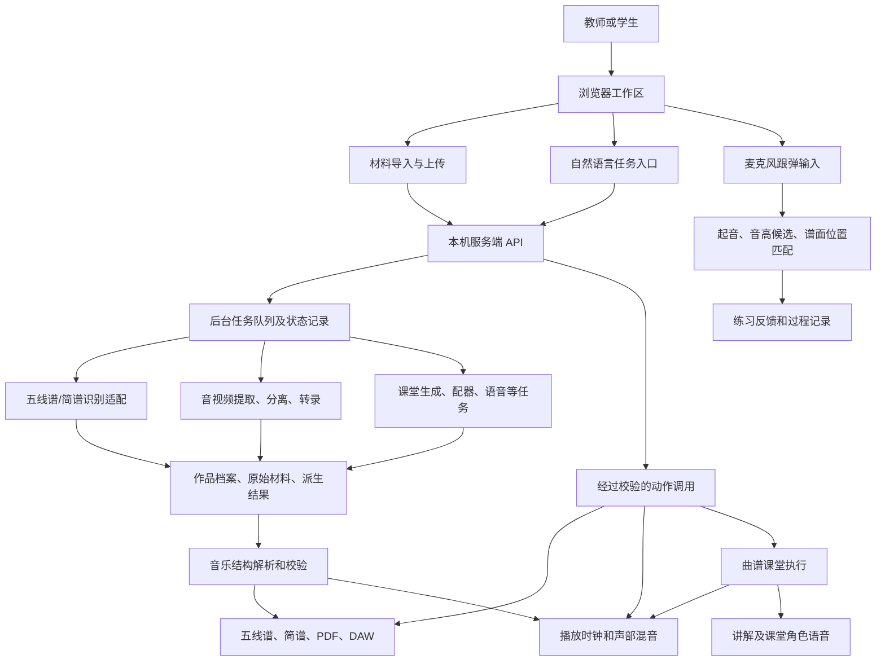

> 2026-10-24补充：技术详解请先阅读[新版全系统技术底稿](面试技术底稿-全系统拓扑及逐层技术机制.md)及[算法附录](面试技术附录-算法推演数据及验证设计.md)。本文件保留口头汇报安排。

# 上海大学博士申请面试准备

唐秋鸣｜2026年10月27日（星期二）

## 汇报定位

建议报告题目：**面向音乐课堂的人机协同教学系统：多模态材料组织、任务执行和学习反馈**。

邹宗峰老师在上海大学管理学院公开主页列出的方向包括商务智能及大数据、金融信息系统、应急管理和区块链商业应用，系所为信息管理系。因此，这次应突出信息系统设计、异构数据组织、可靠任务执行和人机决策，而不把报告做成钢琴软件功能展示。这里是结合公开资料作出的汇报策略，不表示老师已经确定以这些问题招收你。主页发表于2020年，不能用它代替本年度招生口径。

官方资料：https://ms.shu.edu.cn/info/1264/15167.htm

## 开场讲稿（约三分钟）

邹老师您好，我是唐秋鸣，苏州大学音乐学院音乐教育专业钢琴方向2024级硕士研究生，目前研三，准备申请2027年的博士。我带来的是硕士期间持续开发的一套钢琴演奏教学辅助系统，也想借这个系统向您请教，怎样把真实课堂里的工程问题进一步推进为信息系统研究。

我最初是从音乐教学中的具体困难开始做的。教师手里的材料可能是一张手机拍的谱、一份PDF、多轨MIDI，或者只有录音。这些材料可以分别打开，但很难共同回答同一个课堂问题。比如学生说没听清某一句的低声部，教师需要知道是哪首作品、哪个位置、哪个乐器，还要能够马上单独播放，并在下一次追问时保留刚才的位置。把聊天窗口放在播放器旁边，并不能解决这个问题。

所以我逐步把项目的重心放在三个环节：先把不同来源的材料整理为可以核对的音乐事件；再让谱面、播放器和自然语言操作共享同一套作品与位置状态；最后把这些操作嵌入课堂流程，让“请聆听这一段”能够真正触发声音，并在结束后接回讲解。

这套系统也在苏州工业园区星海实验高级中学参与过教学实践。这里我需要区分两件事：系统进入课堂使用，是已有经历；它是否显著提升学习效果，还需要规范的实验设计和数据分析，不能仅凭演示成功就下结论。我现在最想继续研究的是：当系统可以给出即时反馈时，怎样安排反馈时机和解释方式，才能帮助学生形成判断，而不是让他们依赖屏幕提示。

接下来我先用一个课堂任务演示系统怎样工作，再展开它的数据结构和执行机制，最后汇报哪些地方已经有工程验证，哪些地方仍然是需要研究的问题。

## 系统拓扑：讲清部署关系和数据流



这是一张逻辑拓扑，不是所有模块都独立部署成微服务。当前浏览器承担交互、谱面渲染和主要播放控制；服务端承接上传、存储、模型适配、长任务管理及外部服务访问。不同任务可能依赖本机进程或外部服务。FRP和IPv6属于访问链路，不是识谱算法；外部连接器也不能说成本机自研模型。

一条典型路径是：上传文件→建立任务→保存原始材料→识别或解析→得到结构化结果→校验音乐结构→保存作品→打开谱面→播放器执行。另一条是：用户提问→定位作品及上下文→产生候选操作→校验作品、声部和小节范围→执行→把实际结果交回对话。

## 数据层：为什么几个视图能够讨论同一处音乐

MusicXML适合表达音符、时值、谱表、声部、调号、拍号和记谱关系；MIDI主要保存事件时间、音高、力度、通道、程序号及控制信息。两者不是等价格式。PDF和照片首先是版面，不能直接当作音乐事件；音频则需要从连续信号估计音符及其时间。

讲解时可用如下事件说明，但不要宣称代码中恰好存在同名结构：

```text
作品标识 / 乐器与声部 / 小节位置 / 拍内位置
音高 / 持续时值 / 原始力度 / 速度变化
原始来源 / 识别状态 / 可核对的版面位置
```

关键不在字段数量，而在单位和坐标的统一。符号时值转换到拍域后，才能与播放位置对应；速度映射再把拍域转换为实际秒数。显示位置不能反过来充当播放时钟。PDF还需要页码和页面坐标，不能用重新排版后的电子谱横坐标去画原稿色块。

## 各模块的机理及现场说明

| 模块 | 技术机理及要说明的边界 |
|---|---|
| PDF五线谱导入 | PDF渲染与光学乐谱识别是两步。识别涉及谱线、符号、音高、时值及谱表关系重建，随后导出结构化乐谱。系统负责引擎适配、任务编排、结果校验和入库，不应把上游模型算法声称为个人原创。 |
| 拍照导入 | 图片先做文档预处理，处理纸张边界、旋转及透视，再按用户确认的页序进入识别。裁切不能误删谱号、标题或页边的延续小节。 |
| 简谱识别 | 不能只读数字，还要结合上下加点、下划线、延音、休止、拍号和声部版式，恢复相对音级及持续时间。必须说明当前支持和失败的样式，不能承诺任意手写简谱。 |
| MIDI导入 | 读取轨道、通道、程序号和节奏事件，保留多乐器关系；鼓轨按打击乐语义处理。用速度事件形成时间映射，不能把整首曲子一律套成固定速度。 |
| MusicXML导入 | 解析part、staff、voice、duration/divisions以及backup/forward等时序信息；同一小节多个声部必须分别累计位置，不能逐条串联。 |
| 音视频转录 | 视频先提取音频；混合音频按需要分离目标乐器，再估计音符起止及音高。音符级转录不等于记谱完成，还需要节拍、量化和声部分配。 |
| 云曲库 | 保存作品档案和派生结果，使识别、改名、封面及导入结果能够复用。缓存必须有内容身份和结果版本，否则同名作品和旧结果会混淆。 |
| 标题与封面 | OCR标题需要区分作品名、作者和制谱者，匹配失败再处理文件名。封面检索成功只能提供线索，不能证明标题必然正确。 |
| 多视图显示 | 五线谱强调记谱语义，简谱表达音级和节奏，PDF保留原稿，DAW显示轨道和时间。它们应共享作品位置和声部选择，而不是各自启动一套播放状态。 |
| 实时播放 | 播放应由音频时钟驱动，界面动画只读取进度。调度需要提前安排即将发生的音符，不能依赖每一帧动画触发声音。逐小节重新启动会造成间隙。 |
| 音色和混音 | MIDI程序号映射到乐器音源；静音、独奏和轨道音量作用于声部混音。更换视图不应重置播放时钟。采样音源加载、失败回退和复用是工程问题。 |
| 自然演奏 | 先保留拍点和乐句结构，再调整力度、音长及有限的时序偏移。随机扰动不是音乐表现力。需要用节拍偏差、乐句呼吸及主观听评分别检验。 |
| 人声同步 | 人声和符号播放需要共同的时间基准。固定提前/延后适合补偿整体偏移；如果存在随时间增长的漂移，就不能仅靠一个偏移值解决。自动对齐效果需要单独验证。 |
| 和弦与曲式分析 | 从实际音符、低音、节拍位置和持续关系构造候选，再结合上下文解释。瞬间同时出现的音不一定构成独立和弦；非和弦音、踏板和转调都是难点。曲式判断应区分规则结果与模型推断。 |
| 配器和鼓伴奏 | 保留旋律和和声骨架，控制乐器音域、声部密度、节拍重音和织体。鼓型应建立在节拍网格上，而不是每个钢琴音触发一次。生成后的总谱和试听都是核验渠道。 |
| AI Agent | 语言理解之后必须转成可校验动作。作品、声部、范围和播放状态需要解析明确；执行结果应回写上下文。模型说“已播放”不算证据，播放器的真实状态才算。 |
| 曲谱课堂 | 根据曲目、学段和目标组织教学环节，再把讲解、PPT、聆听、活动和问答作为有状态的执行过程。课件文本写“播放30秒”不等于系统已经执行播放。 |
| 教材联合导入 | 教案、教材、音频和曲谱要区分来源角色及对应关系；同名材料未必是同一版本。外部材料需经过来源核验，不把搜索摘要直接当作教学事实。 |
| 语音与多角色 | 文本合成、媒体缓冲、播放授权和角色切换是不同环节。教师及学生使用不同声音；语音实际开始后才推进对应提示。预合成正文和短姓名问候的分工有助于降低等待。 |
| 数字人及三维场景 | Three.js负责场景、相机、骨骼或程序化动作；音量包络可驱动开口，但这不是音素级唇形同步。飞行规划、异步资源加载、视锥裁剪和释放属于渲染系统工程。 |
| 真实键盘及手型 | 音符事件映射到键位，手部分配与指法是另外的推断问题。键盘亮键不等于正确指法；三维动作必须满足手指关节和键位约束，不能据此宣称专业演奏动作已重建。 |
| 跟弹练习 | 麦克风输入经过起音、音高或复音候选估计，与谱面事件匹配。环境声、踏板及复音会影响结果；音符匹配准确度不能代替对音色、指法和音乐性的判断。 |
| 任务中心 | 长任务具有排队、运行、完成、失败和重试等状态，关联具体作品。用户看到的百分比应反映实际阶段或已完成单位，不能把缓慢走动的假进度作为性能证据。 |
| 性能优化 | 优先显示首屏，延后重模块；大型谱面避免在视图切换时重复解析和全量排版；场景按可见性加载并释放不用的资源。WebAssembly只能优化合适的计算热点，不能替代性能分析。 |
| 远程访问与权限 | 浏览器经HTTPS及隧道访问本机服务；上传、外部服务授权和文件获取需要不同权限边界。共享服务凭据不等于把密钥放进浏览器。 |

## 20分钟现场顺序

1. **0—3分钟：问题。** 使用开场稿，不先播放长篇数字人导览。
2. **3—6分钟：一个真实任务。** 打开已经检查过的多声部作品，提出“只听这一段低声部，再慢一点”。说明操作怎样落到作品、声部、位置和速度。
3. **6—9分钟：结构。** 显示同一位置的五线谱、简谱或DAW，说明共享时间轴；展示原稿核对。选两种即可，不要为展示全面而反复切换大型谱。
4. **9—12分钟：课堂。** 使用预先生成并核对过的课堂，演示一轮“讲解—播放—回到讲解”，并指出老师可以中途改变顺序。
5. **12—16分钟：技术。** 展开拓扑，细讲一个识谱时序错误和一个Agent执行错误。展示修复逻辑，而不是罗列模型名称。
6. **16—20分钟：研究。** 讲研究问题、实验设计及仍未解决的边界，留时间请老师判断学科切入点。

现场不要把临时联网识谱或大模型生成当成唯一演示路径。备好一份可离线打开的作品、一份已生成课堂、一段带声音的屏幕录像。备用材料应明确标为预先生成，不冒充实时结果。

## 最值得深讲的三个故障

**小节末尾多等几拍。** 表面像音频卡顿，实际可能是拍号、时值换算、声部累计或小节补齐错误。正确排查顺序是核对原稿→检查解析出的拍号与时值单位→检查声部时间线→对照播放器实际调度，不能简单删掉所有休止。

**Agent说完成，界面却没执行。** 对话生成和动作执行不是同一条可靠链路。需要可执行动作、前置条件校验、任务状态及真实结果回写。范围越界应先查当前作品和合法范围，不能直接把模型错误丢给用户，也不能猜一个小节号硬执行。

**课堂说“请听”，音乐却没响。** 教学文本必须绑定播放动作及完成事件。还要处理浏览器授权、资源就绪、用户跳转和旧回调失效，确保旧环节不会在新环节突然继续讲话。这个问题体现的是跨媒体流程的一致性。

## 博士阶段的问题：从产品转为可证伪研究

建议聚焦：**在音乐学习任务中，反馈时机和可解释程度如何影响学生的错误修正、迁移表现及对系统的依赖？**

技术平台提供可控条件，但不能把功能数当作自变量。可比较即时反馈与乐句后反馈、仅定位错误与提供可听对照。记录错误复现、纠正耗时、练习路径、无提示后的迁移表现及教师评价；使用平行材料控制熟悉度，考虑先前乐器训练、作品难度、顺序效应和教师差异。正式实验前先做识别误差及系统延迟评估，否则学生反应可能只是在回应错误提示或等待卡顿。

与信息管理方向的联系，是研究智能系统怎样组织证据、怎样把建议落实成可靠行动，以及这种设计如何影响人的决策和行为。这里是可讨论的研究切入点，不要为了迎合公开方向，硬加区块链或声称已经形成成熟理论。

## 可能的追问和回答要点

- **究竟哪些是你做的？** 展示模块适配、统一数据与时间处理、任务编排、交互及课堂执行的代码和案例。清楚注明上游模型、接口及第三方组件；系统创新不要求所有基础模型都自行训练。
- **是否训练过模型？** 只能用训练脚本、数据来源授权、训练时长、权重和对比实验作答。音色参考提示、参数调节及调用外部模型不能直接称为从头训练。
- **创新在哪里？** 提出候选贡献：音乐语义约束下的可执行Agent、跨表示位置一致性、可测量的课堂反馈闭环。是否构成学术创新，还须文献对照和实验，不宜说“绝对创新”。
- **识谱准确率多少？** 没有统一测试集就说尚未完成系统评测。分别报告音高、时值、谱表/声部和小节对齐，不能以“导入成功率”代替准确率。
- **课堂效果如何？** 实际试用经历、可展示的操作记录和受控实验结论分开说。班级数、人数、数据规模未经统计不报估计数。
- **大模型会不会胡说？** 回答哪些字段由原始谱面计算、哪些是检索资料、哪些是模型推断；操作需要范围与权限校验，解释需要保留来源。
- **现在还有什么没做好？** 坦诚说明复杂复音转录、错误识别传播、自然演奏稳定性、弱网体验及数字人逼真度等仍有限制，并给出下一步评测方式。
- **为什么需要读博？** 因为平台已能支持控制和记录真实任务，但“有效反馈”和“可靠人机协同”的因果机制还没回答，需要系统的方法训练和长期研究。

## 带到现场的证据

准备一张拓扑图、一张模块与代码对应表、一个完整任务日志、一个失败及修复案例、一份数据字段样例和一页研究设计。学生原始资料需匿名化。不要只带能联网的网址。

可现场定位的实现入口：服务端`server.py`；连接器说明`docs/SCORESTARLING.md`；导师讲解`dist/narration-opening.js`；三维及运镜`dist/mentor-arrival.js`；播放`dist/player.js`；谱面`dist/engraving.js`、`dist/simple-notation.js`、`dist/daw.js`；Agent`dist/workspace-ai.js`及服务端AI相关模块；课堂`dist/score-classroom.js`与`services/openmaic/`。具体算法和运行参数以面试前实际代码核对为准，上表不是逐项完成验收的承诺。
