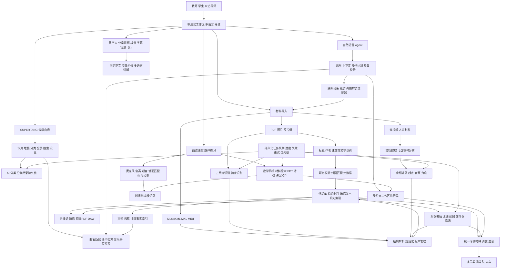
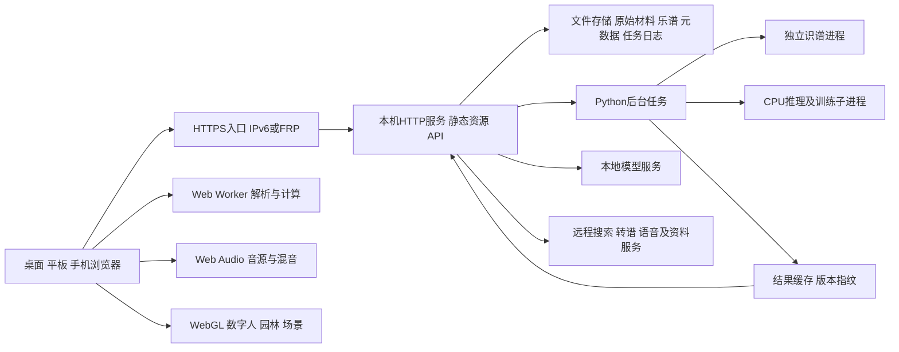
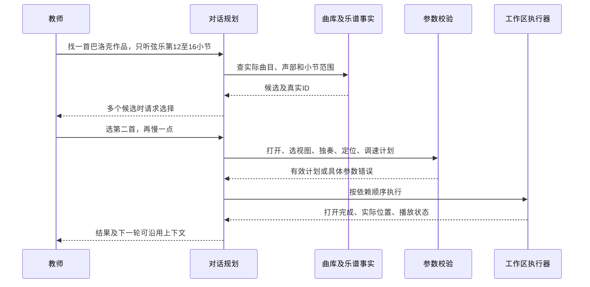
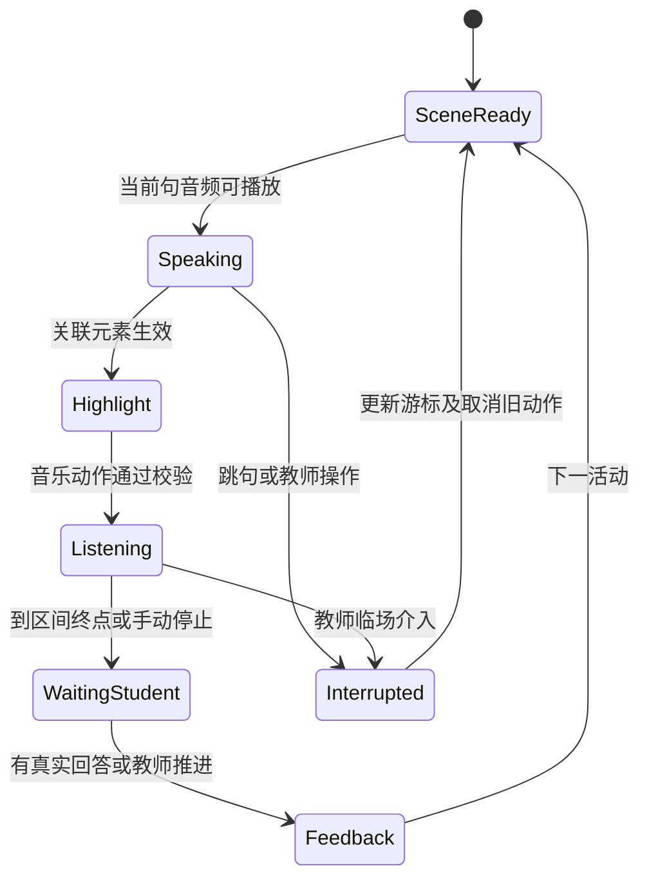

# 苏州大学钢琴演奏教学辅助系统：全系统拓扑及逐层技术机制

唐秋鸣博士申请面试技术底稿｜代码核查日期：2026年10月24日

## 阅读说明

这份底稿用于回答“系统究竟怎样工作”，不是宣传文案。正文围绕材料进入、音乐结构建立、声音生成、教学组织、交互执行、运行保障展开。阅读顺序不等于开发顺序。面试时先讲一个真实课堂问题，再沿数据路径深入，不必逐项念目录。

全文采用四种标记：**【现有实现】**表示在当前代码中找到对应实现；**【模型机理】**解释所调用模型所属技术路线，不表示这些基础模型由本人从零训练；**【设计推导】**给出合理的工程解释或应满足的不变量，不表示所有分支均已经测试；**【研究扩展】**表示值得推进、尚不能作为已完成成果介绍的方法。找到代码不等于验证效果，任何“更快、更准确、更自然”的判断仍需相应测试数据。

项目集成、问题诊断、数据结构设计、交互组织和教学应用，可以作为自己的研发工作陈述。基础算法的来源、模型权重的来源及许可证应在论文参考文献和软件说明中保留。原理讲解可以不以工具名称为中心，但不能把使用、适配、微调写成原创算法发明。

## 一、研究对象不是一个播放器

这套系统试图维持一个跨材料、跨界面、跨课堂活动仍然可定位的音乐对象。纸面上“第二行第三小节的左手”，播放器里的某个时间区间、DAW里的某条音轨、课堂讲解里的聆听片段、Agent对话里的“刚才那段”，需要指向同一份作品的同一版本、同一声部和同一位置。系统困难由此产生：图像识别错一个拍号，不只损失一个字符，还会改变小节长度，继而影响光标、人声对齐、课堂聆听和Agent定位。

因此可以把研究对象定义为：**面向音乐教学任务的多模态乐谱对象，以及围绕该对象形成的可执行教学过程。** 当前系统为研究提供了原型与部分过程记录；它还不自动构成已经证明有效的教学干预。

### 1.1 功能拓扑

图中的连线表示数据或调用关系，不表示所有模块运行于同一进程。曲谱课堂和Agent复用播放器、曲目ID及声部ID，正是避免两个“看起来粘在一起的系统”的关键。

### 1.2 部署及资源拓扑

【现有实现】服务端以Python模块组织API和后台任务；浏览器中有MIDI Worker、谱面排版、音频调度、曲库动画、课堂和三维场景模块。模型推理通过隔离环境或子进程运行，避免把所有依赖塞进HTTP请求线程。此图是逻辑部署图，不应描述成已经部署了分布式微服务集群。

### 1.3 核心对象和关联键

【设计推导】一份作品至少涉及：`workId/digest`、原始文件指纹、原始文件名、经确认标题、标题来源、乐谱版本、声部ID、谱表ID、声部内voice编号、小节序号、原始小节标签、拍内位置、绝对四分音符时间、速度事件、音频时间、PDF页码及矩形。小节显示为“12”不意味着它一定是数组第12项；弱起、反复、第一第二房子、插入小节都会打破这种简单等同。

统一事件可概括为`{scoreVersion, partId, staff, voice, measureIndex, beat, pitch, duration, velocity, program, channel, percussion}`。这里是跨模块解释模型，不声称所有文件使用完全相同的JSON字段。版本键必须进入缓存及异步回调，否则上一首曲子的排版结果可能覆盖下一首。

## 二、先说明数据：到底采集、标注和训练了什么

### 2.1 四类数据不能混为一谈

第一类是**基础模型预训练语料**。其数量、语言、版权和划分属于模型发布方的训练说明；使用权重不意味着本人采集或训练了这些语料。第二类是**本项目导入的业务材料**，例如用户曲谱、音视频、人声及教案，进入系统并不等于进入训练。第三类是**本地适配数据**，例如有授权的导师语音片段，可以进入指定的声学训练。第四类是**教学实证数据**，包括真实学生的练习、反馈、课堂决策和学习结果，必须有采集范围、人数、时间、授权及分析程序。

面试中不能把“曲库有上万首”“基础模型用过大量音乐”“本人训练了上万首总谱”互换使用。当前尚未核实一份由本人完成的上万首配器训练数据清单、训练配置及评估结果，因此此说法不能写成已完成事实。

### 2.2 识谱研究需要怎样的数据集

【研究扩展】一个可复现实验集至少分成电子排印谱、扫描谱、手机拍照谱、简谱、复杂多声部总谱五组。标注应同时保留页、行、谱表、小节线、符号框、连接关系、MusicXML及校订记录。只标注音高，无法评估符杠和声部；只给最终MIDI，无法判断原稿几何定位是否正确。

训练、验证、测试应按作品或版本族划分，而不是把同一作品相邻页随机打散。相同排版模板、同一曲目不同分辨率、裁切后的局部图像可能泄漏。建议记录出版社或来源、字体、像素尺寸、倾斜角、拍摄设备、光照、透视强度和难度等级。增强数据可模拟模糊、噪声、透视和阴影，但必须保证符号关系标签随几何变换同步变化。

### 2.3 本地语音训练的已知证据

【现有实现】`scripts/train-voxcpm-mentor-lora.py`读取对齐片段，保留1.5—8秒、转录置信条件合格、文本长度不少于5字、不过载且具有足够能量的样本。该次记录为**114段训练片段、11段验证片段、训练音频约272.06秒、114个优化步骤**。配置仅开启声学DiT部分的LoRA，秩4、缩放8，学习率`1e-5`，梯度裁剪1.0；语言模型及投影适配未开启。记录标记`production=False`。

验证区域从一个录音来源的前45秒留出，优于随机拆相邻片段，但仍不是跨录音设备、跨场景、跨语言的独立泛化实验。验证损失约1.1204只能说明该损失定义下的结果，不能直接换算成“还原度百分之几”。已有权重变化记录证明发生过优化更新，不证明比旧音色更好听。

另一路声学适配脚本只训练说话人投影层，冻结主体模型。准备数据脚本本身仅生成清单，不是训练；提示音频推理也不是微调。申请材料应分别称为“参考音频条件生成”“说话人声学适配试验”“声学低秩微调试验”。

## 三、材料进入：上传完成和识别完成是两件事

【现有实现】音视频接收端按1MiB块读入、同步累计SHA-256，先写临时文件，接收完成再转为正式源文件。照片组先接收各张图片，用户确认顺序后创建页清单及独立任务。由顺序页ID计算组指纹，保证重新排序的照片组不会误用旧结果。音视频默认名按类型生成序号，避免把转录模型名称或表演者名单当作品名。

上传进度的分母是总字节数，识别进度的分母应是页数、帧段或模型处理量，两者不能拼成“上传到100%就处理失败”的误导状态。网络中断时，需要说明源文件是否完整、是否已入队、能否续传、重新提交会不会重复。现有块式读取不等于已经实现分片断点续传；后者还需分片ID、已收分片表、合并校验及过期清理协议。

【现有实现】图片整理分支有EXIF方向修正、RGB转换、尺寸上限和按页组装PDF。不能仅凭“照片导入”入口就宣称已经对每一张图完成可靠的透视、去阴影和曲面展平；这些能力需要分别核查和测试。

## 四、图像层：先把可读图像交给识别器

### 4.1 原生PDF和照片的区别

原生PDF可能含矢量笔画与文本，也可能只是一张扫描图。矢量谱按目标DPI栅格化可以得到较清晰的符号；低清扫描PDF放大后只会增加插值像素。文字层可用于标题候选，但PDF字体映射损坏时提取出的Unicode可能乱码，不能把“可复制文字”等同于正确文字。

【现有实现】`server.prepare_score`根据页面面积与目标栅格尺寸调整PDF页面尺度，普通分支按300DPI估计，精细分支按400DPI估计，以控制识谱器面对的像素预算。大页保持宽高比，利用PDF页面重绘保留矢量内容。精细分支提高目标解析尺度，不等于自动换成了另一套识别网络。面积控制也不能修复模糊、遮挡或污损。

### 4.2 透视矫正

【模型机理／研究扩展】平整纸面拍摄可用四角确定单应矩阵：`s[x',y',1]^T = H[x,y,1]^T`。先检测纸面边界，再约束四边形凸性及面积，估计H，把梯形还原为矩形。五线谱本身提供额外证据：同一谱表的线间距应大致稳定，横线应接近平行。角点误差会把局部音符压扁，因此应显示或保存变换参数以便核对。

纸面不是平面时，单一H不够。书脊弯曲会使谱线呈曲线，需要估计二维位移场或网格，把不同位置分别展开；仅旋转整张图不能纠正页弯。透视矫正属于全局平面几何，曲面展平属于空间变化形变，应分开说明。

### 4.3 歪斜、页弯和谱线坐标

倾斜角可从长横线的霍夫变换、投影峰值或方向估计得到。旋转后应重新估计谱线，避免重复插值。页面弯曲可沿x方向追踪五条谱线的局部中心，拟合平滑曲线，再按局部谱间距归一化。注意线条不能在符头处盲目跟随黑色区域，否则容易被音符吸偏。

【研究扩展】建立局部坐标`u=x，v=(y-y_staff(x))/spacing(x)`，能把不同纸张尺寸与拍摄尺度归一到相近谱间距。此坐标特别有利于识别加线、符头位置及调号；但书页严重遮挡时仍应报告不确定，而不是编造缺失音符。

### 4.4 光照不均、阴影与摩尔纹

光照不均可以建模为`I(x,y)=R(x,y)L(x,y)+noise`，其中R近似纸面反射内容、L是缓慢变化的照明。估计背景场后作归一化，或采用局部阈值，比固定全局阈值更能保留阴影区细线。不过局部窗口过小会把谱线当背景抹掉。自适应阈值、形态学处理都需要以实际线宽和谱间距确定尺度。

摩尔纹通常来自印刷网点、屏幕条纹与相机采样的频率混叠。可检查频域周期峰，做谨慎的陷波或多尺度去纹；但谱线本来就是强周期结构，直接消除横向频率会误伤五线谱。因此处理前后应比较谱线连续性、符头边界和细小附点，而不是只看画面“更干净”。

低分辨率会把附点、断奏点、连音线与污点混在一起。超分辨率可改善视觉呈现，却可能生成不存在的笔画。用于研究时应同时保留原图，把增强图识别结果与原图证据结合，不把生成式增强当真实观测。当前并无充分证据证明上述增强方法全部进入生产识谱链，应作为分项升级方向。

## 五、OCR：从二维页面到一维字符序列，再回到页面语义

### 5.1 为什么“从一维字符序列讲”仍不能忽略二维版面

OCR的输出常是一行文字的有序字符序列，但输入是二维图像。完整路径是区域检测、文本行裁切、方向校正、特征编码、序列解码、版面复原。标题、作者、歌词和谱内标记必须先分区：标题往往居中、较大并靠近首页上方，但“作曲”“编配”“制谱”字段可能更醒目，不能简单拿最大字号文本。

【模型机理】行识别可把宽度方向的特征序列记为`h1…hT`，输出每个位置的字符概率。CTC引入空白符，对能折叠成目标文本的所有对齐路径求和，避免要求逐字切分：`P(y|x)=Σπ:B(π)=y P(π|x)`。重复标签先合并、空白再移除，使“人人”等重复字符仍可通过有间隔的路径表达。该解释针对CTC路线，不代表当前每个OCR组件都采用同一网络结构。[CTC原始论文](https://www.cs.toronto.edu/~graves/icml_2006.pdf)

### 5.2 页面语义不能靠语言模型猜

【现有实现】项目有标题解析、校验、文件名回退及封面检索模块。应保留`rawText、bbox、confidence、candidateRole、titleSource`等证据。一个候选若含“作曲、演唱、编配、制谱、版权所有”，其标题角色评分应降低；独立歌曲名候选可以结合书名号、首行布局、音乐平台结果做校验。

“匹配到封面”只能增加可信度，不能证明名称正确。音乐平台同名曲、歌手专辑封面、搜索引擎模糊匹配都可能返回图片。可靠机制是比较曲名、作者、版本等多项一致性，并允许手动改名覆盖自动结果。自动任务不得再次把用户改名覆盖成旧OCR值。

对文件名回退可去扩展名、下载编号及明显版本修饰；空格或连字符前缀仅应作为候选之一。例如外文标题中的连字符可能属于合法曲名，不能无条件截断。OCR修正要有旧值、新值、来源和时间，以便解释曲库标题为什么改变。

### 5.3 文字速度和音乐速度

“Allegro”是速度术语，不是唯一BPM；`♩=96`才提供明确节拍单位及数值。识别必须把附点四分音符、八分音符等单位一起读入。`dotted-quarter=60`对应每秒一个附点四分音符，不是每分钟60个四分音符。`rit.、a tempo、poco mosso`属于变化指示，不能随意折算成一个全曲固定速度。

题名、作曲者、编曲者、作词者、演奏版本、速度、拍号、调性应分别存储。把所有OCR字符串拼到标题里会直接破坏曲库检索、封面匹配、分享卡片和Agent消歧。

## 六、OMR：图像层、符号层、结构层、语义层、应用层

OMR输出不是“看起来像文字的一串音符”，而是一套含同时性、时序和层级关系的音乐结构。单个符头识别正确，不保证声部正确，更不保证播放器的时间线正确。五层划分适合解释错误如何向下游传播。[OMR技术综述](https://arxiv.org/abs/2006.07885)

### 6.1 符号层：先识别什么，再判断它连到谁

符号层候选包括符头、符干、符尾、符杠、附点、休止符、加线、谱号、调号、临时记号、小节线、连线、反复记号、力度与演奏法。每个候选包含类别分布、位置、尺度与置信度。谱线与符头接触、符干与小节线相似、连音线与延音线外形相近，均要求上下文，而不是只用局部分类。

传统或混合路线通常先获得连通片段、线性结构和符号候选，再用关系规则组合。神经网络检测路线可以输出对象框和类别；端到端路线可直接输出线性化记谱结构，但复杂钢琴谱仍需解决多声部与二维组织的表达。当前生产分支调用独立识谱引擎逐页转录，不能把行业上所有检测器都写为本人设计。

### 6.2 符头、谱线和音高

以高音谱号为例，谱表每移动半个线间距对应一个自然音级位置变化，不是一个半音。应先确定谱号和谱表局部坐标，再将符头位置映射到字母音名及八度，最后结合调号、临时记号得到实际音高。低音谱号、移调谱号、八度标记和移调乐器都可能改变映射。

MIDI音高可表示为`12(octave+1)+naturalPitchClass+alter`。但MIDI音高相同不代表记谱相同：升C和降D的和声语义不同，结构化乐谱应保留`step/alter/octave`，不能仅保留0—127整数。

### 6.3 符干、符尾与符杠分组

符头和符干按接触、距离、方向及尺寸组成候选音符。符尾或符杠层数决定基本时值；符头空心或实心也影响时值。附点乘以`1+1/2+1/4…`，连音组再改变实际时值比率。检测到两条杠不等于可以直接写成十六分音符：还要排除相邻声部符干、斜线装饰和破损笔画。

符杠是一种节拍分组和视觉连接证据，不能单独决定声部。跨谱表连杠常见于钢琴，连接的音符可能位于不同谱表；反过来，同一谱表内向上、向下符干可以分别属于两个voice。应区分“排印谱表”“逻辑声部”“左右手演奏分配”，三者不是同一个字段。

### 6.4 和弦的声部耦合

同一符干连接的多个符头通常共享起音，构成和弦事件；但共享符头、异向符干、不同延音长度会造成多声部耦合。不能因为多个音横坐标相近，就把它们全部写进一个`chord`。印刷对齐误差、错开的二度和弦符头、全休止符中心对齐都会干扰这种简化。

【研究扩展】可以把识别结果写成图：节点是符号，边是`attached-to、same-onset、same-voice、belongs-to-staff、accidental-of、beam-group`。优化目标兼顾几何似然和音乐约束，例如`L=λg Lgeometry+λr Lrelations+λt Ltiming+λv Lvoice`。其中声部连续性可参考音区跨度、符干方向和前后时间连续性，但必须允许交叉声部，不能硬性规定“最高音永远是voice1”。

### 6.5 声部归属和时值守恒

声部归属的基本检验是：同一voice的时间推进是否自洽，出现的重叠是否由和弦、延音或合法复调解释。正常4/4小节以四分音符为单位长度为4；2/2同样长度为4，但强拍组织不同；4/2长度为8。把4/4错识别成4/2会让播放器每小节多等待4个四分音符，听起来像卡顿。

不能为“填满小节”而在所有异常后自动补休止。要先分清漏音、漏休止、多voice的backup、弱起小节、装饰音、延音跨小节与拍号变化。真正的音乐静默必须保留；识别错误造成的假空拍才应修正。

### 6.6 调号与临时记号

调号在谱号后按固定排列及位置出现，可形成对后续音级的默认升降；它不是某个相邻音符的局部修饰。临时记号应绑定到指定音级、八度及作用范围，并在小节边界或后续记号处按记谱规则更新。还原号要撤销既有改变，重升、重降不能简化成单升降。

移调乐器另有“写谱音高”和“实际音高”两层。单簧管、圆号等导入后若只按记谱音高发声，会与钢琴不协和；若导入器已经转换，再转换一次又会产生二次移调。应在数据契约中明确转换责任，并用已知单音测试验证。鼓谱使用非定音打击乐映射，不能套用上述音高解释。

### 6.7 连音、延音、休止、反复

延音线连接同音高，播放应合并持续或避免重新起音；连音线主要表示乐句或奏法，不意味着所有音合并。跨小节延音不能被当成缺音，装饰音也不能像正常时值一样推进整拍。反复与第一第二房子要求建立“书写顺序”和“播放展开顺序”的映射；不能通过简单小节数组索引解决所有跳转。

【设计推导】若软件暂未完整展开某类反复，应明确限制；否则同一PDF小节可能被播放多次，却无法知道光标应该匹配第几次。该区分也影响课堂中的“重听第二次主题”和人声时间线。

### 6.8 当前逐页输出究竟有多流式

【现有实现】`server.recognize`把PDF拆页，每页独立运行识别，获取MusicXML后合并，更新`partialXml、partialPages、revision、completedPages`。因此可以“完成一页显示一页”，不必等待全曲。它不是逐笔画实时神经网络解码，也不是识别出一个音符就立刻可靠输出一个音符。

失败分支保存诊断日志，包含退出码、超时和没有导出结果等情况。重试时先处理本任务私有输出目录，避免已有目录触发Windows183错误。精细重识别保留旧版本，方便比较；当前代码注释说明精细／替代入口可能仍以更高解析尺度重读PDF，不能仅按按钮名字认定已使用另一模型。

### 6.9 识谱评价要分层

符号检测可看类别F1、定位IoU；结构关系可看符头—符干、符杠组和voice归属准确率；音乐事件可看音高、起音、时值F1；应用层还要看小节完整率、播放多余静默、PDF点击定位误差和课堂片段调用成功率。不能只报告OCR字符正确率，就宣称整份钢琴谱识别准确。

## 七、简谱是另一种结构识别任务

【现有实现】`jianpu.py`将文字OCR和局部图形检测组合：OCR取得数字及坐标，按纵向中心聚行；对数字上下区域检测八度点、下方减时线等，再推导事件和MusicXML。数字1—7不是固定音高，需要`1=C`等调性基准；0表示休止，横线和附点改变时值，上下点改变八度。

局部点检测需区分高低八度点、附点、标点和污点。数字上方歌词或和弦标记也会污染候选区域。多行简谱并不自动等于多声部：歌词行、旋律行、伴奏行需要先做角色判断。正式多声部简谱应保留分组、声部名、共同小节边界和同时性，不能把全曲所有音按顺序写成一串数字。

当前局部二值化和连通域阈值存在尺度敏感性，应在不同分辨率、印刷字体、扫描噪声和多声部谱上独立验证。面试可以如实说明这是组合识别路线，并把复杂版面解析作为尚需系统评估的部分。

## 八、结构层：MusicXML与MIDI如何进入同一时间系统

### 8.1 MusicXML不是XML里按顺序排几个音符

【现有实现】解析必须处理`divisions、duration、chord、backup、forward、staff、voice、time、sound tempo`。每读到普通音符，游标前进；和弦后续音符复用上一个起点；backup回退游标用于另一声部；forward推进而不发声。最终小节长度不能靠把所有音符duration相加获得。[MusicXML记谱教程](https://www.w3.org/2021/06/musicxml40/tutorial/notation-basics/)

建议用有理数表达拍值，避免三连音累计成3.999999后触发额外休止。项目规范化模块使用Fraction处理部分换算，并明确保留原part/staff结构，避免历史修复逻辑把左右手移植到同一voice。当前存在旧辅助函数，介绍时应看真正执行路径，而非看到函数名就称其启用。

### 8.2 MIDI的时间、通道和音色

MIDI的tick依赖PPQ。若每四分音符P个tick，则`beat=tick/P`；速度图把拍映射到秒：在每个速度区间累加`Δtick×microsecondsPerQuarter/(P×10^6)`。拍号负责小节组织，不负责替代速度。把文件头某个数当BPM或把ticks直接当毫秒，都会让速度完全错误。

音轨、通道、乐器program和谱面part不是一一对应。一个音轨可能含多通道，多个轨可能共享通道。鼓一般按打击乐通道及标记识别，以音高编号选择鼓件，不能用钢琴采样播放。音符配对应使用通道、音高及重叠实例，处理note-on velocity0等同note-off、延音踏板和悬挂音。

MIDI不保留完整排版和拼写。转五线谱时需要量化、连音判断、声部拆分、休止补全、音符拼写、连线和断行。保留原始演奏时间层，另建记谱层，才能既让原始演奏可听，又避免自由速度导致谱面异常细碎。不能把量化后的时值回写覆盖原始演奏，造成“导入以后变慢、打架”。

## 九、音视频：声音分离不等于转谱

【现有实现】独立媒体子进程提取音轨、解码为单声道44100Hz，限制单次时长，再调用钢琴转录模型。当前转录按16秒窗口、8秒步长处理，逐段回报；输出音符再生成MIDI及双手谱。稳定速度网格分支关闭了局部拍速追踪，以避免逐帧速度变化引发小节重置。

【模型机理】转录需要推断每个音的音高、起音、释放以及可能的力度。钢琴有衰减长尾、踏板共鸣和复音重叠，频谱中一个峰不等于一个音。模型需要结合时间上下文抑制谐波假阳性，并分辨同音重复起奏。精确识别绝对起止秒数以后，还需节拍与时值量化，才能得到可读乐谱。

【现有实现】当前音频转谱的双手分配包含以MIDI60为界的音区划分。这是工程近似，不是成熟手部分配模型。交叉手、高音区左手、低音区右手都会出错。可以提出改进：结合同时发音数量、跨度、前后移动成本及原有voice推断，形成可编辑的手分配；不能称现有代码已自动理解真实指法。

【现有实现】显式分离选项调用频带分离类音乐源分离模型，CPU模式下长录音限制更严格；默认检查不会为判断混音而自动启动昂贵全曲分离。**分离**得到钢琴波形，**转录**得到音符事件，**记谱**得到可读MusicXML，三者必须分别评价。钢琴转录链不能自动宣称能恢复交响乐每一种乐器的完整总谱。

## 十、云曲库、AI分类、封面、搜索

### 10.1 云曲库保存的是作品状态

【现有实现】曲库关联源文件指纹、XML结果、元数据、变体、任务和封面；服务端曲目列表有缓存及文件时间戳失效机制，避免每次刷新都完整解析所有谱子。浏览器卡片负责摘要展示，打开作品时再取较重的乐谱对象。未就绪作品需要保留可追踪的任务关系，不能因为XML尚未生成就从任务中心消失。

重名不是重复。两份《致爱丽丝》可能是不同调、难度、编配或演奏录音。内容摘要相同可直接复用；标题相同只应触发比较候选，不能自动删除某份作品。用户改名属于元数据更新，需要同步列表缓存、当前乐谱标题、导出文件名及分享摘要。

### 10.2 AI分类到底输入什么

【现有实现】分类模块和检索模块使用真实曲库条目及其元数据调用模型，并解析结构化结果。分类结果应只包含存在的作品ID，保存类别和成员关系。用户给“按年代”“按教学用途”“按钢琴独奏和合奏”等规则后，模型生成分组，不应该生成曲库没有的作品。

【设计推导】同一作品可能同时属于“浪漫主义”“慢速聆听”“和声分析”；分类是多标签还是互斥分组，需要产品明确。证据缺失的年代不能只凭封面风格猜测。为提高稳定性，应有未分类分组、重复归属检查和规则版本，使重新分类不会悄悄丢曲。

卡片叠和发牌动画只是分类结果的可视化。分类准确性应看分组一致性、标签证据、用户调整次数；动画流畅度看帧时间和布局跳动，两者不能用同一个“AI效果很好”概括。

### 10.3 本地检索优先、音乐事实过滤、语义补充

【现有实现】`music_index.py`从MusicXML提取乐器、声部范围、小节数、同时起音和弦类别及声部内和弦计数，缓存为结构事实。`music_query.py`识别乐器、时期、和弦等查询约束，分类模块的语义检索可补充自然语言关联。应先做低成本曲名及事实匹配，再进行模型语义扩展，避免简单曲名搜索也等待长生成。

当前和弦检测把**同一个part内、同一起点**的音高类集合与模板比较，尝试各个根音，因此可识别部分转位的和弦类别。但它未必计算前一个音延续至当前起点的垂直和声，也未必合并不同part的和声，更不等于功能和声分析。分解和弦、非和声音、缺省根音和经过音需要更复杂的时窗与上下文模型。

【研究扩展】完整方案可用音符活动区间构造时间切片，计算持续音集合，再结合低音、调性、声部进行、节拍重音和句法约束，输出候选和弦、置信度及证据小节。向量检索可以补充旋律轮廓或音乐描述，但当前未核查到完整的旋律向量数据库及ANN评测，不能把它直接说成已实现的大规模音乐向量搜索。

### 10.4 联网搜歌、找谱和转谱

【现有实现】线上模块包括音乐搜索、曲谱页面检索、下载解析、外部转谱连接器及服务端导入。Agent和曲库搜索应走同一服务能力，保留“本地已找到／联网候选／远程处理中”的状态区别。网页URL不是PDF下载URL，需判断Content-Type、跳转、实际文件签名和来源页面，避免把HTML错误页送进识谱器。

远程连接器可能需要授权、额度、异步轮询和导出；这些都不能伪装成本地瞬时识别。验证码可将受阻步骤交给用户完成，完成后恢复有状态流程，而不是宣称任何验证都能自动越过。外站账户、令牌、密码不进入论文、前端包或公开日志。

【设计推导】检索结果逐个或按批返回，先展示已确认候选，剩余请求继续进行；对超时来源保留局部成功结果。展示所有结果应采用增量列表或窗口化，不能为了不限制数量而把数千张高清卡片同时放进DOM。用户选择具体版本后再下载或转录，可以减少错误导入和重复任务。

## 十一、谱面、PDF、简谱、DAW共享播放位置

### 11.1 排版不等于缩放

【现有实现】五线谱和简谱有独立排版模块，MIDI也有记谱布局模块。音符横向拥挤可能来自把过多小节固定塞进一行、duration映射不一致、音符宽度估计过小、临时记号和歌词未计入最小宽度，不能一概用整体缩放修复。

【设计推导】先按符号密度计算小节最低宽度，再安排系统断行，最后对整行做有限伸缩。手机可减少每行小节，但不能把多乐器总谱压成互相重叠的一行。乐器名称需要属于谱表系统的布局元素，考虑语言长度及声部状态；不要靠绝对定位贴在视口上，否则滚动后会失配。

### 11.2 PDF原稿几何和点击定位

【现有实现】`pdf_geometry.py`以固定宽度栅格图检测水平谱线，按线间距组合五线谱，利用垂直墨迹连接判断系统，再找跨谱表小节线。小节矩形采用页面百分比坐标，便于显示缩放。小节线数量与XML分配匹配时用真实检测边界；不匹配时存在按系统宽度均分的回退。

这解释了为什么行数可能正确，行内小节却仍不准确：回退提供了可点击区域，但并不是逐小节真实标注。要把色块精确卡在小节线之间，需输出边界来源及置信度，低置信区域不能装作精准。像素阈值、弱小节线、歌词、跨页或复杂总谱都应进入评估样例。

光标坐标应限制在当前矩形内：`x=left+clamp(localBeat/measureLength,0,1)×width`。但这只是一种均匀拍进度近似；原稿横向排印按符号复杂度分配空间，真实音符定位还要利用符头或源XML坐标建立分段插值，不能把拍数线性等分冒充逐音符位置。

### 11.3 跟随、跳转和视图切换

【设计推导】播放状态由传输控制器持有，视图只是订阅者。切换五线谱、简谱、PDF、DAW不应销毁音频图或重建播放起点。页面跟随应滚动谱面容器，而非不断拖动整个手机页面；手动触摸后可暂时让出跟随，防止按钮被拉走。

四视图共享`scoreVersion+playbackPosition`，但各有版面索引。异步排版返回时比较版本，丢弃过期结果；初次打开视图显示当前有效片段，重计算在后台进行。大型乐谱按系统或小节窗口渲染，离开窗口可以释放DOM，但保留轻量几何缓存。不能简单把四套完整SVG永远隐藏挂在页面里，这会增加内存与重排负担。

### 11.4 DAW和人声轨

DAW按音轨呈现事件，横轴是统一时间或拍，纵轴为轨道和音高。轨头包含真实乐器名称、音量、静音及独奏；名称来源不能只靠一个可能为空的轨道字段，应综合part名、program和可用映射。鼓以鼓件映射显示，音频人声以波形展示。

手势缩放改变显示变换，不修改事件本体。双指缩放时保持触点下的时间锚点，才能避免轨道突然跳走。轨道音量应改变实际GainNode，不只是滑块填充色；静音或独奏应更新实时混音，不从头重新播放。

## 十二、音源发声、演奏表情和统一时钟

### 12.1 从音符到声音

【模型机理】采样音源按音高和力度选择样本，并按半音比`2^(Δmidi/12)`改变播放速率。多力度层可减少强奏弱奏只是音量不同的机械感；释放包络、共鸣、踏板与声像也影响听感。跨乐器播放必须使用各自program映射，不能把所有事件交给同一个钢琴采样器。

【现有实现】项目有`piano-samples.js、instruments.js、player.js`及多音源加载逻辑。资源需要按乐器复用，不能每换曲重下同一钢琴；失败回退要按资源组进行，显示当前真实乐器名。加载完成应立刻结束等待，不应为了“匀速进度”继续空转。

### 12.2 为什么小节边界不能重新启动播放器

【设计推导】音频调度应基于单调递增的AudioContext时间，使用短前瞻窗口排队，而不是每小节等待一个定时器结束再调下一个小节。UI计时器不是音频时钟：主线程掉帧可以让光标慢，但不能让音符也晚触发。后台标签节流、解码、视图重排都可能干扰主线程，应尽量与音频调度隔离。

拍到秒的转换要积累速度图，而不是用当前BPM重新计算整曲。人声、乐器、节拍器和光标要共享传输起点及暂停位置。静音操作不改时钟，换音色不改已过拍值，谱面渲染不发起新的play。

### 12.3 模型演奏的当前约束

【现有实现】`scripts/render-performance.py`以钢琴事件构建MIDI，调用演奏生成模型，再核对音符数和音高顺序。模型输出若破坏对齐，拒绝替代原演奏。代码将生成时轴作首尾尺度归一，并将事件起音相对名义网格的偏移限制在±0.06秒；和弦内差异也被限制，事件保持最小递增间隔。

这种约束回应了“有表情但节拍不稳”的实际问题：自然感不应通过无界随机抖动获得。模型可调整力度、时长和小幅起音，但必须保护拍点、和弦同时性及段落总时长。当前参数是工程选择，不是已证明适用于所有速度和风格的最优参数；快板密集音型、低速抒情和复调作品应分别测试。

自然演奏还包括旋律层级、低音落点、伴奏弱化、乐句动态和奏法。仅把每音时间随机扰动不会形成呼吸，反而破坏节奏。适合的研究是比较“网格演奏”“规则表情”“受约束模型表情”，测节奏偏差、听感评分和教学用途，而不是只说用了模型所以更像真人。

## 十三、人声绑定和同步

【现有实现】`vocal_alignment.py`从乐谱建立每秒5帧的音级参考，当前偏向取最高音作为旋律候选；音频解码为11025Hz，4096点窗、2205点步长，计算90—1400Hz范围的频谱音级特征。搜索时间比例0.9—1.1及偏移约±40秒，按相似度和候选间隔判断是否接受。只有分数及区分度达到阈值才自动移动，否则保留原时间请求核对。

这不是完整的人声跟谱算法。最高音不一定是主旋律，音级特征丢失八度，重复副歌可能产生多个相似峰；当前全局比例不能处理逐句自由速度。保守拒绝优于错误自动对齐。可扩展为受约束DTW、旋律提取及分段锚点，但必须防止为追齐而把人声不断拉扯，造成断续。

播放时更稳妥的原则是保持连续音频流，用共同起点和有限偏移对齐，避免每次光标更新都seek音频。暂停、跳小节和恢复时重新算一次人声位置；静音不停止传输。精细“提前／延后”控件修改偏移量，显示值、保存值和实际播放映射必须一致。

## 十四、配器、改编和鼓谱

【现有实现】`arrangement_music.py`有拍号与小节映射、模型时间规整、鼓型和声部进行成本函数；`arrangement_notation.py`承担独立乐器记谱。应区分生成候选、规则约束、总谱导出和音源渲染四个环节。模型输出很多音符不代表音乐层次成立。

【设计推导】配器至少考虑旋律保留、和声支撑、音域、转位、声部距离、移动成本、织体密度和乐器可奏性。可以把候选音的代价写为`C=α×越界+β×不协和+γ×跳进+δ×声部交叉+ε×密度`，但具体权重和优化算法必须以实际实现为准，不能把公式当成已训练的新模型。

鼓应从小节、拍号、强弱拍和段落出发，而不是从钢琴每次note-on出发。基础律动、弱拍装饰和段尾加花需要不同概率和密度限制；加花的结束应回到下个段落强拍。鼓的音高编号是鼓件，不是和声中的音级，“鼓加花不和谐”可能是音源误映射，也可能是律动密度与重音错误，需分别诊断。

鼓谱独立part，使用打击乐谱号与合适符头，保留不同鼓件和同时性，不能混到钢琴左右手。室内乐、管弦乐等变体沿用作品标题，加编制或版本说明；打开变体必须携带对应版本ID，避免声音已换而谱面仍显示原版。

## 十五、跟弹练习、指法、键盘、3D手型

【现有实现】练习模块接收麦克风音频、估计音高及起音并与当前谱面比较，区分练习会话和普通自动播放。音符准确度、节奏与速度统计应在练习开启后显示。练习计划校验小节范围和选定乐器，不能把全曲小节数与某个稀疏声部的局部数组长度混用。

【模型机理】单音基频估计和复音钢琴识别难度不同。频谱峰可能是谐波；踏板使历史音持续；扬声器伴奏可能被麦克风重新录入。低置信候选应保留“不确定”，不能计作学生弹错。评估需说明起音容差、音高容差、是否允许延迟、漏音和多音怎样统计。

【研究扩展】学生演奏与谱面可用带约束的序列对齐，允许漏音、插音和重复。实时系统不能只用离线最优全局对齐，因为未来音符尚未发生；可使用有限窗口、候选路径和置信度迟滞，避免光标因一次错音前后跳。反馈时机本身应成为教育研究变量，而不只是算法阈值。

【现有实现】项目含指法服务、练习指法展示、真实键盘和3D手型模块。指法不是按音高固定映射1—5，应考虑手跨度、重复音、连奏、换指、跨指和乐句。3D手指示范则还需将指法映射到键位、手腕及关节约束；视觉动画不能自动证明动作符合钢琴技术。应保留教师修改和关闭示范的能力。

## 十六、Agent：从一句话到可验证的界面动作

### 16.1 规划、校验、执行、观察

【现有实现】Agent相关模块分为能力清单、直接控制、曲库控制、课堂控制、网络导入和任务存储。语言模型负责把口语映射到结构化动作，执行器负责真正调用工作区。用户说“刚才那段慢一点”时，需要保留当前作品、版本、声部、小节和上轮目标；不能重新猜作品。

### 16.2 为什么不能承诺“说什么都做到”

模型可以生成动作描述，不代表动作存在或参数有效。系统必须检查真实partId、小节范围、当前作品版本、资源就绪及权限。缺少信息时应主动检索或澄清；工具失败时返回原因，做有界重试或回退。不能让模型假称成功，也不能无限循环找方法，持续消耗资源而不给用户结果。

【现有实现】课堂动作校验禁止任意JS和任意网址，指定动作类型、参数范围及单次步骤数。这个受约束工具层比“让模型直接操纵任何东西”更可测，也有助于防止网页材料中的提示注入改变系统行为。

### 16.3 流式输出与进度

应用层NDJSON可以先返回检索状态和局部结果；模型本身是否流式是另一层。当前部分语义检索调用内部为`stream=False`，按批次输出应用进度，因此不能称为每个模型都逐token秒回。稳定性还需要请求ID、取消归属、连接重试、结构化解析和幂等工具调用。

面向用户可显示“正在核对曲库候选”“已找到3首，检查弦乐声部”“正在读取第12—16小节”等**可核验活动**。不必也不应伪造模型内部思维过程。任务中心保存目标曲谱、活动、百分比、结果链接及失败原因，比一个长时间停在0%的模糊提示更有用。

## 十七、曲谱课堂：生成教学过程，而不是生成一篇讲稿

### 17.1 教学输入和课件结构

【现有实现】课堂入口基于当前作品、范围、学段、目标及补充材料生成课程，关联场景、讲解、可视元素、动作、课堂观察和修订记录。小学、初中、高中、钢琴个别课不应只替换年龄称呼：聆听任务、问题深度、音乐术语和活动组织都不同。

“全曲”应采用作品全局有效范围，而不是界面曾选中的1—4小节；切曲后新课程必须绑定新版本。课程生成可以按场景逐步输出，但只有结构校验通过的部分才发布，不能把半个JSON直接放进课堂执行。

### 17.2 PPT、插图和补充材料

PPT需要标题层级、有限文字、谱例、图片、图表、活动提示和音乐片段。真实联网图片应有实际下载成功、可访问文件和内容相关性证据；不能用“此处插入图片”冒充已完成图文课件。图片数量本身不是教学质量指标，必须服务于音乐概念和活动。

【现有实现】有课堂图片修复、材料导入和资料检索模块。联合导入教案、教材、音频时，应区分已解析文本、已完成转录及尚未理解的文件。材料中的文字是引用内容，不是对Agent的新系统指令。来源可以不占PPT画面，但需保存在资料清单及导出说明中。

### 17.3 课堂动作状态机

【现有实现】`classroom_runtime.py`登记了32种动作名：21种通用呈现／交互动作和11种音乐动作。包括语音、激光、聚焦、白板文字／图形／图表／公式／表格、讨论、活动状态、视频、音乐聆听、定位、暂停、停止、速度、独奏、混音、音量、视图、材料播放、场景跳转。**登记与参数验证不等于每一种动作已在各端完成端到端测试。**

真正的融合发生在“请听这一段”后直接调用同一播放器，监听真实播放结束事件再继续讲解。不能用固定30秒定时器猜播放已结束；也不能让语音、框选、PPT页码各自维护互不相干的游标。点击PPT某个区域，应同时更新讲解位置和高亮目标；中断时必须取消旧语音回调，防止后续突然跳页。

### 17.4 学生、助教与实证记录

模拟学生可以用于演示讨论和问题分支，但模拟发言不是学生学习数据。不同角色需要独立音色、发言顺序和可视提示，避免教师学生同时说。真实观察记录包含场景ID、会话ID、类别、值和时间戳；当前实现限制单份课程保存的记录条数，因此不能称为无限量学习档案。

编辑课件采用revision检查，避免旧界面覆盖新课件；修改讲稿会使对应音频失效，防止字幕已变声音仍旧。研究上可以进一步分析教师何时跳过系统建议、学生何时要求重听，但要保留真实事件和模拟事件的来源标签。

## 十八、TTS、音色复刻与多语言

### 18.1 固定正文与动态问候分开

【现有实现】数字人讲解采用固定正文预合成、姓名问候动态生成的分工。网页最早阶段发起问候准备；模型只生成“某某老师您好”一类短句，再与正文衔接。这样不必为每个导师重做长篇讲稿，降低CPU负担并提高一致性。需要裁掉正文原有重复问候，统一采样率、响度和停顿，避免双重“老师您好”。

背景音乐先响不表示语音就绪。应分别管理问候、正文、BGM与浏览器音频解锁；以真实音频缓冲和播放事件作为状态，不靠“请求返回了”推断能立即说话。浏览器的自动播放策略不能由网页保证绕过，初次需要用户手势时应立即反馈，不能在按钮上无响应。

### 18.2 语音生成的不同技术路线

【模型机理】语义token路线先用文本和参考声音条件预测语音表征，再由条件声学生成器和声码器还原波形。条件流匹配可学习噪声到目标声学特征的速度场，以较少积分步骤生成，参考说话人嵌入约束音色，文本控制内容。它不是把原录音剪字拼句。[多语言语音模型论文](https://arxiv.org/abs/2505.17589)

另一条连续表征路线不先把音频完全离散成码本token，而在连续声学潜空间结合自回归与扩散生成；有利于解释细粒度声音信息的保留，但实际质量取决于参考数据、模型版本和推理配置。当前本地0.5B试验与项目仓库以后出现的新版本不能混称为同一个已部署版本。[连续表征语音模型说明](https://github.com/OpenBMB/VoxCPM)

### 18.3 声音像、说话自然、字完整是不同指标

音色相似度可比较说话人嵌入或盲听判断；可懂度用人工转写、CER/WER；自然度用多听者评分；首音延迟、实时率和断流次数属于工程指标。声音更像但吞字，不是合格升级。合成损失降低也不自动带来主观自然度提升。

背景音乐和房间混响会污染参考音色。高通、低通和响度归一不能完全分离BGM；需要比较多个来源、挑选高质量连续语句，并人工核查转录。素材越多并非越好：混入噪声和错误文本可能降低模型质量，应记录保留和排除原因。

### 18.4 半监督、跨语言和情感：需要准确命名

**【研究扩展，未核实为本项目已实施】**半监督情感识别可以用少量带情感标签语音训练分类头，再用大量无标签音频做一致性学习、教师伪标签或自监督表征学习。跨语言需要减少语言内容与情感表征耦合，可做语言对抗、跨语言对比或域适配，并在未见语言测试。情感类别标签也需考虑标注者文化差异。

识别情感和生成情感是两个任务。分类器输出“平静”不保证TTS能自然表达平静；需要把情感条件映射到语速、基频、能量、停顿或模型条件向量，再测语义内容和音色是否稳定。当前查到的是说话人适配及声学LoRA，不足以证明已经训练了跨语言半监督情感识别系统。该方法可以作为博士阶段候选研究，不能补写成既有实验。

## 十九、数字人、板书、导览及场景

### 19.1 人物形象和动作绑定

【现有实现】项目包括卡通头部与身体、肖像参考、面向控制、步行、场景抵达、字幕和板书模块。模型部件必须在同一父级骨架或变换链下，头发、头、脖子错位往往来自坐标系、缩放和局部原点不一致，而不只是材质问题。

嘴部可由语音能量包络驱动微动，眼神和头部按目标点插值，手势结合板书重点。但音量驱动嘴型不是音素级唇形同步；可旋转三维模型也不代表已完成毫米级本人面部重建。基于照片的卡通相似度应通过本人／熟悉者盲评验证，不能称为像素级真实还原。

### 19.2 世界坐标、接地、路径和运镜

【现有实现】三维流程包含飞行规划、碰撞检查、场景预取、园林资产流式加载和人物朝向修正。相邻地标的位置可以为展示重排，但此时应称研究演示沙盘，而非精确地理复原。人物接地需要地形高度和脚底基准，不能只把模型中心放到y=0。

【设计推导】飞行要分开路径几何、进度函数、相机朝向和焦距。平滑位置曲线不保证朝向平滑，直接切换lookAt目标会出现点头或回退。路径应在建筑包围体外保留相机体积及安全间隔，树冠也必须计入障碍。落点前预先设置人物正面和黑板正面，避免镜头到了才瞬间纠正背面。

飞行时间用于加载：提前请求下一场景、解析资源、上传GPU并预编译，镜头接近时再显示完整细节。资源未就绪需要明确的连续替代策略，不应把人物留在钟楼循环讲七段，也不能复制第二个化身补位。场景所有权和讲解段落状态必须唯一。

### 19.3 板书、字幕、数字人结束交接

板书内容与当前讲稿段落关联，标题、图示、谱例和重点框由同一段落状态驱动。多语言字幕改变文字，不应重建全部场景。字幕与人声若仅按段落切换，不能称逐字强制对齐；音素或字级时间戳需要额外对齐结果。

数字人结束后停止动画循环、取消请求、移除监听并释放专属几何／材质／纹理；共享资源按引用计数释放，不能一刀切dispose仍被主界面使用的资源。进入钟楼黑板再放大至主页面，需要两端内容、长宽比和帧状态一致，否则视觉上会跳成另一套未加载首页。

## 二十、不卡顿、不溢出：以预算和生命周期管理

### 20.1 首屏和渐进式准备

【现有实现】项目通过分阶段模块加载、样式合并及文本资源压缩降低首屏负担。首先展示真实首页或导览最小场景，后加载排版、模型和非当前面板，避免两套UI切换闪烁。不要等全曲库、全部音源和园林模型准备齐才显示任何内容。

下载字节比例、解析进度和场景编译进度是不同阶段。没有可测分母时显示具体活动或不定进度，不用虚假的均匀百分比掩盖停顿；任务真正完成时立刻到100%。进度估计可以平滑，但不能反过来拖慢已完成界面。

### 20.2 CPU、GPU、DOM和解码内存要分别计算

图片压缩文件只有1MB，不代表内存只占1MB：宽W高H的RGBA纹理约占`4WH`字节，mipmap另增开销；音频解码后按采样率、声道、时长和每样本字节数占用内存；完整乐谱SVG可能有海量DOM节点。JS堆稳定也不代表GPU内存稳定。

【设计推导】设置同时活跃场景数、音源缓存预算、最大解码音频数、可见谱面系统数和纹理尺寸预算。高分辨率资源按视野与距离请求；同类建筑共享几何和材质，通过实例化减少draw call。LOD需要保持轮廓及渐变切换，不能近景才突然变出整幢建筑。

### 20.3 Worker、WebAssembly和浏览器主线程

【现有实现】已有Worker用于部分解析／计算。Worker适合MIDI解析、索引计算和几何规划，但DOM排版和多数界面更新仍在主线程。传大数组可用Transferable减少复制，注意转移后原buffer失效。

【研究扩展】WebAssembly适合明确的CPU热点，如音频特征、数值对齐和几何碰撞，但不会自动加速DOM、网络或无界资源加载。引入WASM前先记录性能火焰图和耗时占比；若热点是主线程SVG重排或音源下载，换语言并不能解决根因。内存不增长、峰值可控、交互时延下降才是有效证据。

### 20.4 音乐后台队列和资源竞争

【现有实现】后台任务有持久化、状态、进度、失败及重试，部分模型单工作线程执行，昂贵步骤通过检查点和低优先级调度。应区分“用户操作不应取消后台任务”和“后台任务不能耗尽前台CPU”，二者不矛盾。

任务记录至少应显示作品、类型、状态、阶段、真实进度、最近更新时间、等待原因、执行者和结果。若等待空闲，要说明哪项任务占资源；若没有当前执行者却长期等待，应由看门狗诊断。只把所有任务写为“等待操作结束”会产生队列饥饿。重试要具幂等键，防止重复收费、重复下载或重复创建曲谱。

### 20.5 验证“极致优化”需要什么

不能承诺浏览器永不崩溃。应在iPhone Safari、平板和桌面上分别记录首屏可见时间、曲谱可操作时间、视图切换P50/P95、长任务数、峰值内存、音频断流与连续切换成功率。大型谱、复杂多声部和弱网络是独立场景，单首小曲通过不能替代全系统验证。

动画连续性还需记录布局跳动、动画取消、DOM搬移和纹理上传时机。保持元素身份、避免动画中重建卡片、用单一进度驱动形变，通常比叠加多轮弹簧更稳定。系统当前已有大量相关修复，但没有覆盖所有设备的完整性能实验，论文中应列测试方案及实际结果表，缺少数据先留空。

## 二十一、全球校徽、分享、语言和权限也属于系统能力

【现有实现】学校发现、校徽检索、机构元数据和分享预览是独立模块。来访者姓名、学校和语言由链接传入；自动匹配需要机构别名、官方域名、图片类型及失败回退，不能用一张苏大图标冒充已经找到其他学校校徽。微信抓取依赖服务器返回的分享元数据，不仅是浏览器打开后JS修改DOM。

多语言需要覆盖静态控件、生成内容、字幕、语音、错误信息及动态按钮，而不只是导航。切换语言保留播放和任务状态，不应重新创建音频。长英文、德文、日文等需弹性布局，按钮不可随意拆词。语言动画属于展示层，不能阻塞状态提交或使移动端键盘遮住输入。

上传认证应由服务端校验，密码不能只在前端判断。会话、外部服务凭据、私密素材和模型权重分别管理；论文展示不需要暴露认证信息。日志中的原始素材路径、令牌和个人身份数据应按访问权限处理。

## 二十二、功能—机制—代码核查索引

以下为阅读入口，不代表对每个文件已完成逐行审计。自动生成的补充索引列出模块函数、类和文件指纹，便于继续核查。

| 功能域 | 机制重点 | 代码入口 |
|---|---|---|
| 上传及作品缓存 | 指纹、原始材料、版本、列表失效 | server.py、storage.py、media_import.py |
| 五线谱识别 | 逐页转录、部分结果、结构保留 | server.py、omr_normalize.py、score_book.py |
| 简谱识别 | OCR位置、上下点、减时线、调号 | jianpu.py |
| 标题及封面 | 多来源候选、校验、改名覆盖 | title_validation.py、score_work_titles.py、song_cover.py |
| 云曲库及分类 | 列表、分组、堆叠、分类结果 | library_classification.py、dist/library.js、dist/library-decks.js |
| 音乐事实查询 | 音轨范围、和弦模板、声部过滤 | music_index.py、music_query.py、ai_catalog.py |
| 联网找谱及转谱 | 搜索、下载、验证、连接器 | online_music.py、score_web_download.py、scorestarling.py、ai_web_import.py |
| 音视频转录 | 音频提取、分段模型、量化 | media_import.py、scripts/transcribe-media.py |
| 音源分离 | 钢琴源估计、显式CPU任务 | audio_separation.py |
| MusicXML及MIDI | 结构解析、速度图、声部保存 | dist/midi-loader.js、dist/midi-worker.js、dist/midi.js |
| 五线谱及简谱 | 最小宽度、断行、视图跟随 | dist/engraving.js、dist/engraving-plan.js、dist/simple-notation.js |
| 原稿PDF定位 | 谱线、小节线、页面几何 | pdf_geometry.py、dist/app.js |
| DAW及混音 | 轨道、键位、实时音量状态 | dist/daw.js、dist/instruments.js、dist/player.js |
| 音源 | 样本缓存、乐器映射、发声 | dist/piano-samples.js、dist/instruments.js |
| 演奏表情 | 事件对齐、有限起音偏移 | performance_service.py、scripts/render-performance.py |
| 配器和鼓 | 拍号、声部进行、独立打击乐谱 | arrangement_service.py、arrangement_music.py、arrangement_notation.py |
| 人声 | 上传、波形、音级匹配、偏移 | vocal_import.py、vocal_alignment.py、dist/daw.js |
| 练习和指法 | 起音匹配、范围、手部分配 | practice_plan.py、fingering_service.py、dist/pitch-stream.js |
| 键盘和手型 | 键位映射、动作同步 | dist/real-keyboard.js、dist/piano-hands-3d.js |
| Agent控制 | 上下文、工具参数、结果回执 | ai_workspace.py、ai_capabilities.py、ai_direct_controls.py、ai_repertoire_controls.py |
| Agent任务 | 持久化、结果、进度 | ai_task_store.py、dist/workspace-ai.js、dist/task-center.js |
| 曲谱课堂 | 生成、材料、动作、观察、编辑 | score_classroom.py、classroom_runtime.py、ai_classroom_controls.py |
| 课件插图及资料 | 检索、引用、图片修复 | classroom_materials.py、classroom_references.py、classroom_image_repair.py |
| 课堂语音 | 多角色、通道、预取 | classroom_voice.py、dist/classroom-online-voice.js |
| 导师语音 | 固定正文、短问候、混音 | mentor_greeting.py、tour_voice.py、lecture_music.py |
| 音色适配 | 数据清单、声学投影、LoRA | scripts/prepare_voice_dataset.py、scripts/train-mentor-acoustic-adapter.py、scripts/train-voxcpm-mentor-lora.py |
| 三维人物 | 头部、身体、面向、动作 | dist/mentor-cartoon-model.js、dist/mentor-cartoon-head.js、dist/narration-avatar.js |
| 场景和飞行 | 预取、路径、安全、场景释放 | dist/mentor-arrival.js、dist/mentor-flight-safety.js、dist/mentor-garden-asset-stream.js |
| 双路线导览 | 学科侧重、连续演示、工作区联动 | dist/guided-tour.js、dist/tour-presentation.js |
| 队列及空闲处理 | 并发、检查点、失败恢复 | background_jobs.py、idle_runtime.py |
| 学校及分享 | 机构消歧、校徽、预览标签 | institution_discovery.py、institution_logo.py、share_metadata.py |
| 语言及动效 | 文案、弹性布局、状态保留 | dist/language-switch.js、dist/locales、dist/motion-continuity.css |

## 二十三、面试时如何讲得具体

可以先拿“识别错拍号造成小节末尾空拍”讲三分钟：原图拍号在哪，符号如何被解释，MusicXML时间单位怎样决定小节长度，播放器为什么出现额外静默，如何区分真实休止和错误填充，修改后用什么用例验证。这个案例把音乐知识、数据结构、音频时钟和工程诊断串在一起，比连续念二十个模型名更能证明熟悉系统。

第二个案例用“课堂说请听，播放器却没有响”：讲稿生成不是教学执行，需把讲解中的动作转为参数化指令，校验曲谱版本和范围，准备音源，等待真实播放结束，再进入下一句；临时跳页要取消旧事件。研究问题可落在教师控制权、自动化可靠性和学生注意分配，而不只是“AI自动上课”。

第三个案例用“学生问把刚才低声部单放一遍”：解释指代消解、当前曲谱状态、真实声部检索、独奏参数、断点播放及结果反馈。继而说明音乐事实索引和语言模型的分工，以及模型不能凭空编造第几小节。当前和弦索引的局限也可以主动提出，展示研究判断而非回避问题。

最后回到博士研究：**同一处演奏偏差，何种反馈时机和呈现粒度能够促进学生形成可迁移的听觉判断，而非只依赖屏幕纠错？** 原型提供统一谱面位置、播放干预及过程记录，实验仍需设置对照条件、控制练习时间、区分即时成绩和迁移保留。星海高中实践可以作为场域与问题来源，人数、课时、效果未统计前不写成定量结论。

## 二十四、面试前需要补齐的证据

1. 识谱测试集：来源、作品划分、校订标准、拍号及声部错误样例、修复前后同条件结果。
2. 各模型版本：权重、输入输出、运行硬件、是否本地适配、训练或推理日志。
3. 音色评估：固定文本和参考素材下的盲听、吞字率、首音延迟及失败率，不能只选最好听的一条。
4. Agent端到端测试：连续多轮、找谱、定位、独奏、备课、失败恢复；记录工具成功率而非只看回答是否通顺。
5. 课堂案例：真实教案、目标、环节、学生作答、教师改动及授权范围，模拟课堂单独标注。
6. 性能测试：同一大型曲谱连续切换、移动端弱网、数字人结束释放、峰值内存及P95交互时延。
7. 基础模型和素材引用：保留论文、许可证和资源清单；自己的贡献按问题、改动、证据分别陈述。

这些不是给项目减分的免责声明，而是把一个功能原型转成可讨论、可复现、可检验研究工作的必要材料。
